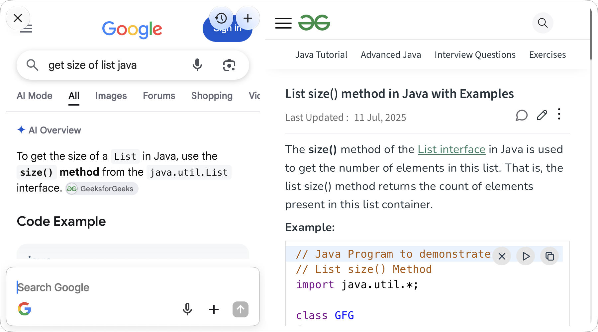
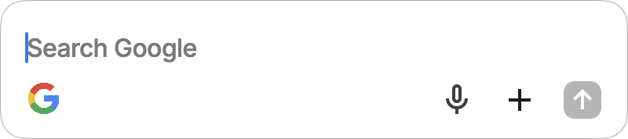
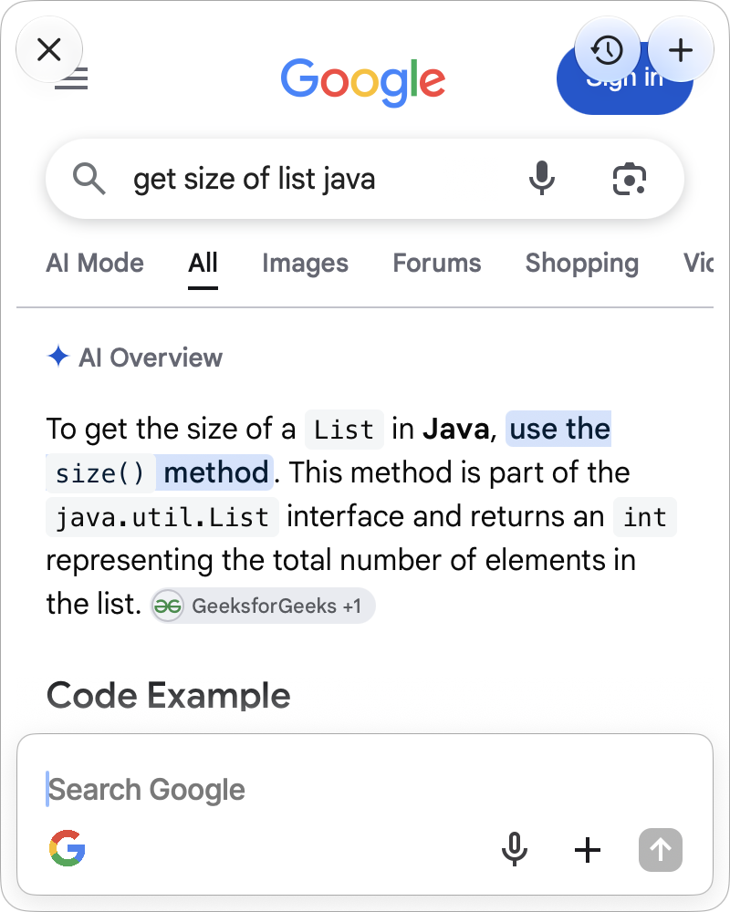
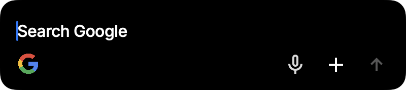
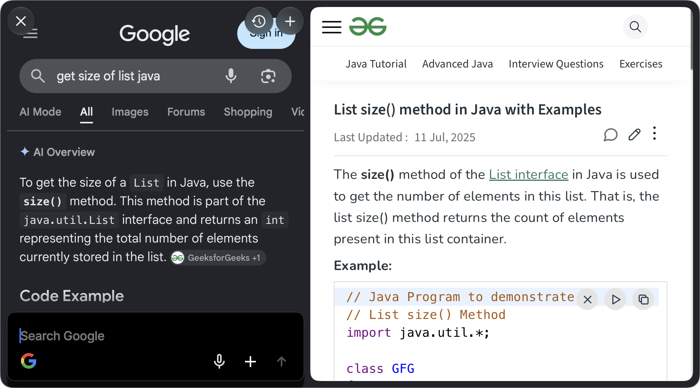

# Grover

**Google, one keystroke away.** Grover is a tiny macOS launcher. Press **fn + Space** to open a floating search bar, type, and the Google results appear right there. Click a result and the page flicks open beside them. Flick through results without leaving the window.

<p align="center">
  
</p>

## How it looks

| Search bar | Results | Results + page |
|---|---|---|
|  |  |  |
|  | |  |

Grover follows your system's light/dark setting, and the window takes on Google's own background colour.

## Features

- **fn + Space** shows or hides Grover from any app.
- **The results pane only ever shows Google.** Any link that leaves Google opens in the side page instead.
- **One side page at a time.** Clicking another result replaces it.
- **Fast flicking.** The top results load in the background, so ⌘↓ / ⌘↑ switch between them almost instantly.
- **Dictation.** The mic button turns speech into your search, on-device where supported.
- **Google Lens.** The + button in the search bar searches with an image file.
- **Recent searches.** The clock button lists your last 20 searches. They're stored locally.
- **Stays out of the way.** The small bar hides when you click elsewhere. Once you've searched, the window stays open until you close it. Drag it anywhere by its edges or the bar's background.

## Keyboard shortcuts

| Shortcut | Action |
|---|---|
| fn + Space | Show / hide Grover |
| Return | Search Google |
| ⌘↓ / ⌘↑ | Open the next / previous result |
| Esc | Close the side page, then hide Grover |
| ⌘W | Same as Esc |
| ⌘N | New search (back to the small bar) |

## Requirements

- macOS 26 or later (Grover uses Liquid Glass)
- Swift 6.2 or later. The Xcode Command Line Tools are enough, and full Xcode isn't required.

## Build and run

```sh
git clone <this repo>
cd Grover
scripts/build-app.sh
open Grover.app
```

`build-app.sh` compiles a release build and puts together `Grover.app` in the repo root. Grover lives in the menu bar (🔍) and has no Dock icon. Quit it from that menu.

### Permissions

| Permission | Why | When |
|---|---|---|
| **Accessibility** | Lets Grover detect fn + Space. macOS doesn't let apps register fn as an ordinary keyboard shortcut. | Asked on first launch |
| Microphone + Speech Recognition | Dictation | The first time you press the mic |

Allow Accessibility in **System Settings → Privacy & Security → Accessibility**. fn + Space starts working within a couple of seconds, with no restart needed.

### Keeping the Accessibility permission across rebuilds

By default the app is signed ad hoc, which gives every build a new identity. macOS then quietly stops honouring the Accessibility permission you granted to the previous build. The toggle still looks on, but fn + Space stops working. To fix it once:

```sh
tccutil reset Accessibility com.yav.grover   # forget the stale permission
open Grover.app                              # allow it again when asked
```

To avoid this for good, sign with a stable identity:

1. Open **Keychain Access → Certificate Assistant → Create a Certificate…**
2. Name it `Grover Dev`, set the type to **Code Signing**, then create it.
3. Build with:

   ```sh
   GROVER_SIGN_IDENTITY="Grover Dev" scripts/build-app.sh
   ```

## How it works

Grover is a SwiftUI + AppKit app built with Swift Package Manager. It has no Xcode project.

- **Window:** a borderless, non-activating `NSPanel`, like Spotlight. It can take keyboard focus without pulling you out of the app you're in. It has three fixed sizes: the bar (400 × 89), results (400 × 500) and results + page (900 × 500). It grows from its bottom-left corner so the search bar stays put.
- **Hotkey:** a `CGEventTap` watches for Space with the fn modifier flag and swallows it.
- **Google pane:** a `WKWebView` with an iPhone Safari user agent, so Google serves its compact layout. Its navigation delegate allows only `google.*` hosts. Everything else is cancelled and sent to the side page. That includes Google's `/url` and `/goto` outbound redirects, `target=_blank` and `window.open`.
- **Results and prefetching:** an injected script reads the result links from the results page, including ones added as you scroll. A small LRU pool of hidden web views preloads the top results and the neighbours of the current one. Each is laid out at the side page's real size, so when it's swapped in there's no reflow.

```
Sources/Grover/
  GroverApp.swift          app entry, menu bar item, Edit menu
  AppController.swift      actions and keyboard shortcuts
  AppState.swift           mode, query, search history
  HotkeyMonitor.swift      fn + Space event tap
  GroverPanel.swift        floating panel, sizing and animation
  BrowserController.swift  Google pane, side page, navigation rules, result scraping
  ResultPrefetcher.swift   preloaded result pages
  Dictation.swift          speech-to-text
  LensUpload.swift         Google Lens image upload
  Theme.swift              design tokens, fonts, resources
  Views/                   SwiftUI views
Resources/                 icons, Inter font, Info.plist
scripts/build-app.sh       builds and signs Grover.app
```

### Development

`swift build` and `.build/debug/Grover` run Grover without bundling it, and resources are loaded from `Resources/`. Debug builds accept a few flags for driving the UI:

```sh
.build/debug/Grover --show                                # open the bar on launch
.build/debug/Grover --show --search "swift arrays"        # run a search
.build/debug/Grover --show --search "swift arrays" --flick 1   # …and open the first result
.build/debug/Grover --dark --show                         # force dark appearance
```

## Known limitations

- **Lens uploads** use the same upload endpoint as lens.google.com. It isn't a public API and could change.
- **Google's page layout** decides which links count as results. If Google changes its markup, ⌘↓ / ⌘↑ and prefetching may stop finding results. Clicking still works.
- **Google sign-in** works inside the Google pane, but sign-in flows that redirect through other domains open in the side page.

## Credits

- Interface font: [Inter](https://rsms.me/inter/) by Rasmus Andersson, under the SIL Open Font License (`Resources/Inter-LICENSE.txt`).
- Icons: Material Symbols (mic, add, arrow) and SF Symbols.
- Grover is an independent project and isn't affiliated with or endorsed by Google. Google and Google Lens are trademarks of Google LLC.
